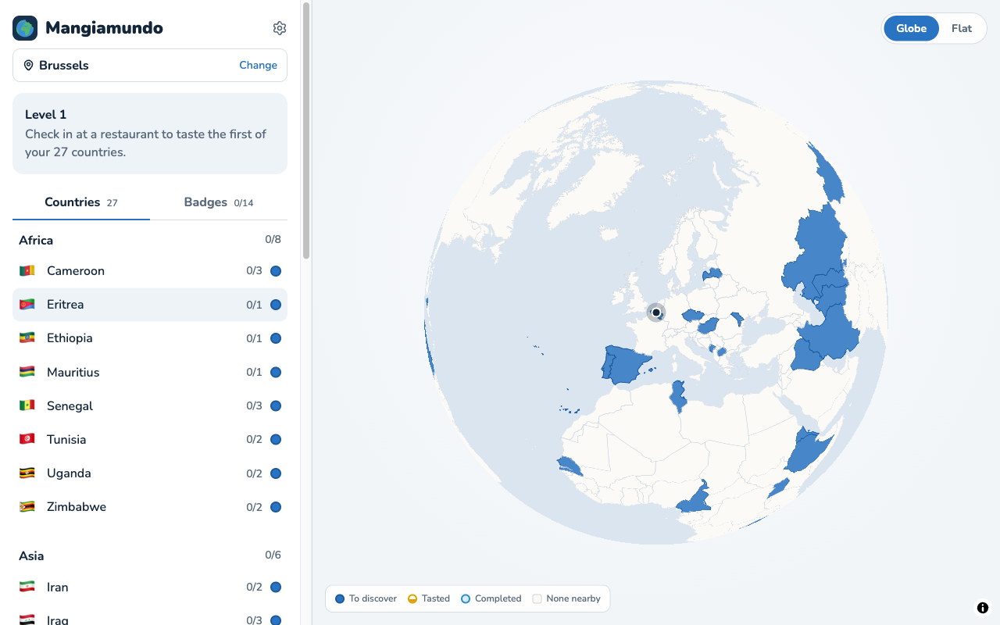
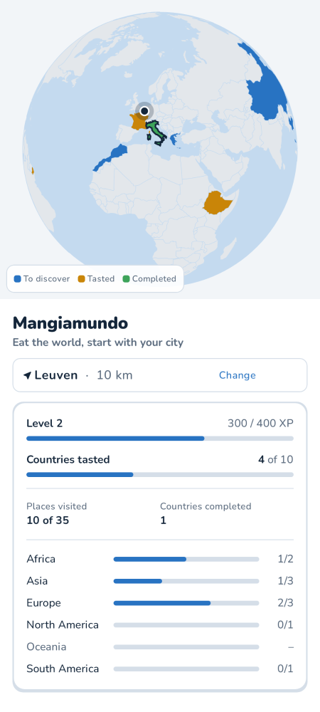

<h1>
  <picture>
    <source media="(prefers-color-scheme: dark)" srcset="docs/logo-dark.svg">
    
  </picture>
</h1>

Eat your way around the world without leaving your city. Every country whose cuisine
you can eat nearby lights up on a world map; check in at restaurants to taste them all.

<p>
  
  
</p>

## How the game works

- Pick a city or postal code. Countries with a restaurant there light up.
- **Tasted**: you checked in at a place of that country.
- **Completed**: you visited every place of that country in your area.
- **Badges** for tasting every country of a continent, or the whole world, in your city,
  plus celebrations and limited-time events.
- **XP**: 10 per check-in, 50 per new country. Level *n* starts at 100·(n−1)² XP.
  A check-in within 250 m of the place is marked as verified.

## Quick start

You need Rust (stable) and Node 24.

```sh
# 1. API on http://localhost:8080, with made-up offline restaurants
cd backend
cp .env.example .env        # optional: all settings, documented inline
PLACES_PROVIDER=demo cargo run

# 2. Web app on http://localhost:5173, proxying /api to the backend
cd web
npm install
npm run dev
```

Search for Brussels, Antwerp, Amsterdam or Berlin in demo mode. Drop
`PLACES_PROVIDER=demo` for real OpenStreetMap data.

Tests: `cargo test` in `backend/`, `npm run check` in `web/`. Mobile apps: see
[`mobile/README.md`](mobile/README.md).

## Repo layout

| | |
| --- | --- |
| `backend/` | Rust (axum + SQLite) API: place lookup, caching, accounts, game logic |
| `web/` | SvelteKit single-page app with a MapLibre map; colours are CSS variables in `web/src/app.css` |
| `mobile/` | Native Android (Kotlin, Compose) and iOS (Swift, SwiftUI) apps, no map SDK |
| `contract/` | OpenAPI document and example responses shared by all clients |
| `tools/` | Scripts that build the country outlines and logos |

## More docs

- [Areas and places](docs/areas-and-places.md): cities, postal codes, OpenStreetMap, caching
- [Celebrations and events](docs/celebrations-and-events.md): data files, time zones, reminders
- [API](docs/api.md): wire conventions, error codes, sessions and accounts
- [Deploy](docs/deploy.md): single binary and Fly

## Data credits

Restaurant data © OpenStreetMap contributors (ODbL) with the `osm` provider. Country
borders: Natural Earth via `world-atlas`. Country metadata: `world-countries`.
Typeface: Nunito by Vernon Adams and contributors, SIL Open Font License
(`mobile/shared/Nunito-OFL.txt`).
